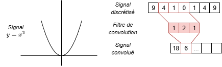
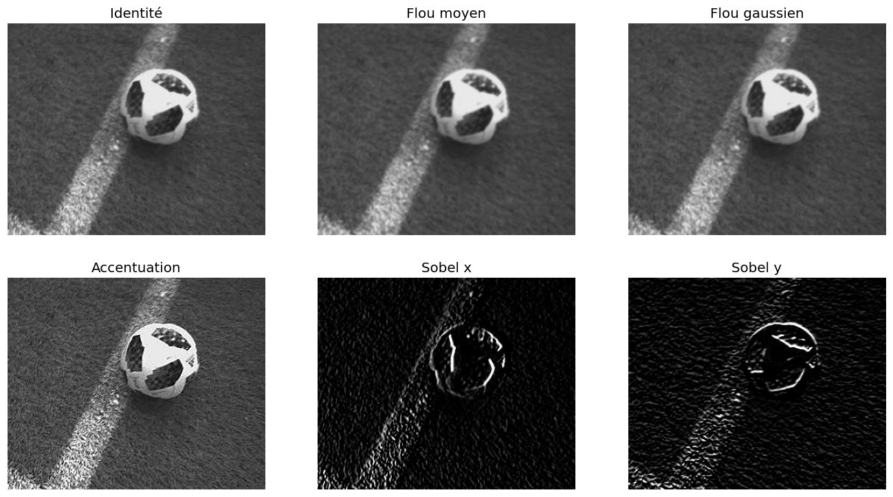
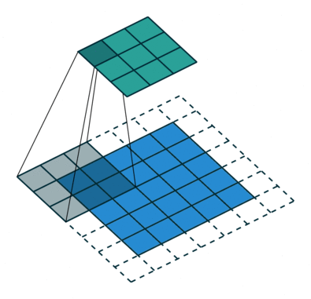
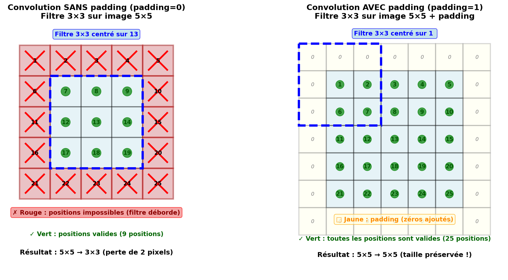

.. slide::

Chapitre 5 — Classification d'images avec un CNN
================

🎯 Objectifs du Chapitre
----------------------

.. important::

   À la fin de ce chapitre, vous saurez : 

   - Comprendre la différence entre un MLP et les réseaux convolutifs (CNN).
   - Calculer une convolution 2D et interpréter ce que détecte un filtre.
   - Utiliser les couches de convolution pour le traitement d'images.
   - Appliquer les techniques de pooling pour réduire la dimensionnalité.
   - Sauvegarder et charger les poids d'un modèle entraîné.
   - Utiliser les datasets PyTorch pour organiser vos données.

.. slide::

📖 1. MLP vs Convolutions : pourquoi les CNN ?
----------------------

Dans les chapitres précédents, nous avons utilisé des perceptrons multi-couches (MLP) pour résoudre divers problèmes. Cependant, lorsqu'on travaille avec des images, les MLP présentent plusieurs limitations importantes.

1.1. Limitations des MLP pour les images
~~~~~~~~~~~~~~~~~~~

Imaginons une image en couleur de taille $$224×224$$ pixels. Si on "aplatit" (avec ``flatten`` ou ``view`` par exemple) cette image pour la donner à un MLP :

- Chaque pixel RGB → 3 valeurs
- Total d'entrées : $$224 \times 224 \times 3 = 150528$$ valeurs

Si la première couche cachée a 512 neurones :

- Nombre de poids : $$150528 \times 512 = 77070336$$ paramètres

**Problèmes** :

1. **Trop de paramètres** : le modèle devient énorme, difficile à entraîner et très gourmand en mémoire.
2. **Perte de structure spatiale** : en aplatissant l'image, on perd l'information sur la proximité des pixels. Or, dans une image, les pixels voisins sont fortement corrélés.
3. **Pas de généralisation spatiale** : un MLP doit réapprendre le même motif s'il apparaît à des positions différentes dans l'image.

.. slide::

1.2. Solution : les réseaux convolutifs (CNN)
~~~~~~~~~~~~~~~~~~~

Les réseaux de neurones convolutifs (CNN, de Convolutional Neural Networks en anglais) résolvent ces problèmes en utilisant des convolutions au lieu de couches entièrement connectées. Une convolution fait glisser un petit **filtre** (par exemple $$3×3$$) sur toute l'image : on verra comment dans les sections suivantes. Chacun des trois problèmes trouve ainsi sa solution :

1. **Trop de paramètres → partage de poids** : le même petit filtre est appliqué sur toute l'image. Il n'a que quelques poids, quelle que soit la taille de l'image (calcul en section 2.1).
2. **Perte de structure spatiale → traitement local** : le filtre travaille sur des pixels voisins, sans aplatir l'image. Les relations entre pixels voisins sont préservées.
3. **Pas de généralisation spatiale → invariance par translation** : comme le même filtre parcourt toute l'image, un motif appris à un endroit est détecté partout (un visage reste un visage, qu'il soit en haut à gauche ou en bas à droite).

.. slide::

1.3. Qu'est-ce qu'un filtre (ou noyau de convolution) ?
~~~~~~~~~~~~~~~~~~~

Un filtre (aussi appelé *kernel* ou *noyau*) est une petite matrice de poids apprenables qui sert à détecter des motifs dans l'image.

- **Taille typique** : $$3×3$$, $$5×5$$, ou $$7×7$$ pixels
- **Fonctionnement** : le filtre "glisse" sur toute l'image, comme une petite fenêtre qu'on déplace pixel par pixel
- **Détection** : à chaque position, il calcule une somme pondérée des pixels qu'il couvre
- **Apprentissage** : les poids du filtre sont appris automatiquement pendant l'entraînement

💡 **Intuition** : imaginez que vous cherchez des visages dans une photo. Vos yeux scannent l'image en cherchant des motifs caractéristiques (deux yeux, un nez, une bouche). Les filtres font exactement la même chose, mais de manière automatique et sur des milliers de motifs différents !

.. slide::

1.4. Comment calcule-t-on une convolution ?
~~~~~~~~~~~~~~~~~~~

**En 1D** : une convolution consiste à faire **glisser le filtre** sur un signal, et à calculer à chaque position la **somme pondérée** des valeurs recouvertes par le filtre.

   **Figure 1** : Convolution d'un signal 1D par le filtre [1, 2, 1].

Dans la Figure 1, le filtre $$[1, 2, 1]$$ est d'abord aligné avec les valeurs $$[9, 4, 1]$$ du signal : $$9 \times 1 + 4 \times 2 + 1 \times 1 = 18$$. On décale ensuite le filtre d'un cran : $$4 \times 1 + 1 \times 2 + 0 \times 1 = 6$$, et ainsi de suite. Le signal convolué complet vaut $$[18, 6, 2, 6, 18]$$.

Une convolution n'est donc rien de plus qu'une **succession de sommes pondérées** ! On remarque que le signal convolué est plus court que le signal d'origine : 5 valeurs au lieu de 7 (le détail du calcul est en section 2.2).

.. slide::

**En 2D** : pour une image, c'est exactement la même chose. Le filtre est une petite **matrice** (souvent 3 × 3) qui glisse sur l'image, de gauche à droite et de haut en bas. À chaque position, on multiplie chaque valeur du filtre par le pixel qu'elle recouvre, et on fait la somme.

**Exemple** : une image 5 × 5 avec une partie sombre (10) à gauche et une partie claire (80) à droite, et un filtre 3 × 3 :

.. code-block:: text

   Image (5×5)                    Filtre (3×3)

    10  10  10  80  80             -1   0   1
    10  10  10  80  80             -1   0   1
    10  10  10  80  80             -1   0   1
    10  10  10  80  80
    10  10  10  80  80

   Filtre centré sur la ligne 1, colonne 2 (pixels entre crochets) :

    10 [10  10  80] 80
    10 [10  10  80] 80     ->   (-1×10) + (0×10) + (1×80)
    10 [10  10  80] 80        + (-1×10) + (0×10) + (1×80)
    10  10  10  80  80        + (-1×10) + (0×10) + (1×80)  =  210
    10  10  10  80  80

   En répétant le calcul pour toutes les positions possibles, on obtient la sortie (3×3) :

     0  210  210
     0  210  210
     0  210  210

.. slide::

**Interprétation** : la sortie vaut 0 là où l'image est uniforme, et une grande valeur (210) là où l'image passe brusquement du sombre au clair. Ce filtre est donc un **détecteur de contours verticaux** !

Avec le même principe, le filtre « moyenne » ci-dessous (toutes les valeurs valent 1/9) remplace chaque pixel par la moyenne de ses 9 voisins :

.. code-block:: text

   Filtre (3×3)                Sortie (3×3)

   1/9  1/9  1/9               10.0   33.3   56.7
   1/9  1/9  1/9               10.0   33.3   56.7
   1/9  1/9  1/9               10.0   33.3   56.7

Le passage brutal de 10 à 80 devient progressif (10 → 33,3 → 56,7) : l'image est **floutée**.

👉 **À retenir** : ce sont les valeurs du filtre qui déterminent ce que la convolution détecte.

.. slide::

**Vérification avec PyTorch** : la fonction ``torch.nn.functional.conv2d`` applique une convolution avec un filtre que l'on choisit soi-même. Elle attend des tenseurs **à 4 dimensions** (*in* : entrée, *out* : sortie) :

- l'entrée : $$(N, C_{in}, H, W)$$ -> un batch de $$N$$ images ayant chacune $$C_{in}$$ canaux (1 en niveaux de gris, 3 en RGB),
- le filtre : $$(C_{out}, C_{in}, k_H, k_W)$$ -> $$C_{out}$$ est le **nombre de filtres**. Chaque filtre a une hauteur $$k_H$$ et une largeur $$k_W$$ (*k* pour *kernel*, le noyau) et s'applique sur les $$C_{in}$$ canaux de l'entrée.

.. code-block:: python

   import torch
   import torch.nn.functional as F

   image = torch.tensor([[10., 10, 10, 80, 80]] * 5)    # (5, 5) : 5 fois la même ligne
   filtre = torch.tensor([[-1., 0, 1],
                          [-1., 0, 1],
                          [-1., 0, 1]])                  # (3, 3)

   x = image.reshape(1, 1, 5, 5)     # 1 image, 1 canal
   k = filtre.reshape(1, 1, 3, 3)    # 1 filtre, appliqué sur 1 canal

   print(F.conv2d(x, k))             # tensor([[[[  0., 210., 210.], ...]]]) -> forme (1, 1, 3, 3)

Les paramètres ``padding`` et ``stride``, qui contrôlent la taille de la sortie, sont détaillés dans la section 2.

.. slide::

1.5. À quoi servent les filtres ?
~~~~~~~~~~~~~~~~~~~

Chaque filtre peut être spécialisé dans la détection d'un type de motif :

- **Contours** : verticaux, horizontaux, diagonaux
- **Textures** : lignes, points, motifs répétés
- **Formes** : coins, courbes, angles
- **Caractéristiques complexes** : yeux, roues, fenêtres (dans les couches profondes)

Les filtres s'organisent de manière hiérarchique :

- **Premières couches** : détectent des caractéristiques simples (bords, couleurs)
- **Couches intermédiaires** : combinent ces caractéristiques pour détecter des formes
- **Couches profondes** : détectent des objets complexes (visages, voitures, animaux)

.. slide::

**Quelques filtres classiques** : avant le Deep Learning, les filtres étaient choisis à la main par des spécialistes du traitement d'images. En voici quelques-uns :

.. code-block:: text

   Identité          Flou moyen            Flou gaussien             Accentuation

   0  0  0           1/9  1/9  1/9         1/16  2/16  1/16          0  -1   0
   0  1  0           1/9  1/9  1/9         2/16  4/16  2/16         -1   5  -1
   0  0  0           1/9  1/9  1/9         1/16  2/16  1/16          0  -1   0

   Sobel x (contours verticaux)        Sobel y (contours horizontaux)

   -1   0   1                          -1  -2  -1
   -2   0   2                           0   0   0
   -1   0   1                           1   2   1

💡 Contrairement au flou moyen, le flou gaussien donne plus de poids au pixel central qu'aux pixels éloignés, selon une courbe en cloche (la gaussienne). Pour obtenir sa matrice 3 × 3, on multiplie chaque valeur de la colonne $$[1, 2, 1]$$ par chaque valeur de la ligne $$[1, 2, 1]$$ :

.. code-block:: text

   ×  |  1   2   1    <- ligne
   ---+-------------
   1  |  1   2   1
   2  |  2   4   2
   1  |  1   2   1
   ^
   colonne

On divise ensuite par 16, la somme des 9 cases ($$1 + 2 + 1 + 2 + 4 + 2 + 1 + 2 + 1 = 16$$), pour que le filtre ne change pas la luminosité de l'image. Un flou gaussien plus grand, en 5 × 5, se construit de la même façon avec $$[1, 4, 6, 4, 1]$$ : la ligne a pour somme $$1 + 4 + 6 + 4 + 1 = 16$$, donc la somme des 25 cases vaut $$16 \times 16 = 256$$. Ces coefficients sont ceux du `triangle de Pascal <https://fr.wikipedia.org/wiki/Triangle_de_Pascal>`_ : chaque ligne s'obtient en additionnant deux à deux les valeurs voisines de la ligne précédente, ce qui revient à flouter une nouvelle fois.

.. slide::

Appliquons ces filtres sur une partie de l'image `ballon.jpg <images/chap4/ballon.jpg>`_ du chapitre 4 (placez-la dans le même dossier que votre notebook Jupyter) :

.. code-block:: python

   import torch
   import torch.nn.functional as F
   import matplotlib.pyplot as plt
   from PIL import Image
   from torchvision import transforms

   gris = transforms.ToTensor()(Image.open('ballon.jpg').convert('L'))   # 'L' : niveaux de gris -> (1, 482, 644), valeurs dans [0, 1]
   x = gris[:, 40:320, 260:600].unsqueeze(0)                            # (1, 1, 280, 340) : zone du ballon + dimension du batch

   filtres = {
       'Identité': torch.tensor([[0., 0, 0], [0, 1, 0], [0, 0, 0]]),
       'Flou moyen': torch.ones(3, 3) / 9,
       'Flou gaussien': torch.tensor([[1., 2, 1], [2, 4, 2], [1, 2, 1]]) / 16,
       'Accentuation': torch.tensor([[0., -1, 0], [-1, 5, -1], [0, -1, 0]]),
       'Sobel x': torch.tensor([[-1., 0, 1], [-2, 0, 2], [-1, 0, 1]]),
       'Sobel y': torch.tensor([[-1., -2, -1], [0, 0, 0], [1, 2, 1]]),
   }

   fig, axes = plt.subplots(2, 3, figsize=(15, 8))                       # 2 lignes × 3 colonnes
   for k, nom in enumerate(filtres):
       sortie = F.conv2d(x, filtres[nom].reshape(1, 1, 3, 3))           # (1, 1, 278, 338) : 2 pixels de moins (pas de padding)
       axes[k // 3, k % 3].imshow(sortie[0, 0], cmap='gray', vmin=0, vmax=1)   # valeurs < 0 en noir, > 1 en blanc
       axes[k // 3, k % 3].set_title(nom)
       axes[k // 3, k % 3].axis('off')
   plt.show()

.. slide::

   **Figure 2** : Résultat du code ci-dessus : effet de différents filtres de convolution sur une partie de l'image ``ballon.jpg`` du chapitre 4, en niveaux de gris.

.. slide::

Quelques remarques sur la Figure 2 :

- Les filtres de **flou** ont une somme égale à 1 : la luminosité moyenne de l'image est conservée. Le flou gaussien donne plus de poids au pixel central et donne un résultat plus naturel que le flou moyen.
- Le filtre d'**accentuation** renforce les différences entre un pixel et ses voisins : l'image paraît plus nette.
- Les filtres de **Sobel** ont une somme égale à 0 : les zones uniformes donnent 0 (en noir). Les **contours** ressortent en blanc là où l'image passe du sombre au clair ; les passages du clair au sombre donnent des valeurs négatives, affichées elles aussi en noir.

.. slide::

1.6. Qu'est-ce qui détermine quel filtre fait quoi ?
~~~~~~~~~~~~~~~~~~~

C'est l'entraînement qui détermine la spécialisation de chaque filtre ! Voici comment :

1. **Initialisation aléatoire** : au départ, les poids des filtres sont initialisés aléatoirement (petites valeurs proches de 0).

2. **Apprentissage automatique** : pendant l'entraînement, l'algorithme de descente de gradient ajuste progressivement les poids de chaque filtre pour minimiser l'erreur du réseau.

3. **Spécialisation émergente** : chaque filtre "apprend" naturellement à détecter les motifs les plus utiles pour la tâche. Par exemple :
   
   - Si le réseau doit reconnaître des chats, certains filtres apprendront à détecter des oreilles pointues
   - Si c'est pour des voitures, d'autres détecteront des roues ou des phares

4. **Pas de programmation manuelle** : on ne dit jamais explicitement à un filtre "tu dois détecter les contours verticaux". C'est le réseau qui découvre lui-même quels motifs sont importants !

Fait remarquable : les premières couches d'un CNN entraîné apprennent souvent des filtres qui ressemblent aux filtres de flou et de contours de la Figure 2. Le réseau redécouvre seul ce que les spécialistes du traitement d'images avaient conçu à la main !

💡 **Analogie** : c'est comme apprendre à reconnaître des champignons comestibles. Au début, vous ne savez pas quoi regarder. Après avoir vu des centaines d'exemples, votre cerveau apprend automatiquement à repérer les indices pertinents (couleur du chapeau, forme du pied, présence d'un anneau, etc.). Les filtres font exactement pareil !

.. slide::

📖 2. Les couches de convolution dans PyTorch
----------------------

Jusqu'ici, on a utilisé la fonction ``F.conv2d`` en lui donnant nous-mêmes le filtre (flou, Sobel…). Dans un CNN, on ne choisit pas les valeurs des filtres : on utilise la **couche** ``nn.Conv2d``. Elle crée ses propres filtres, initialisés au hasard puis **appris** pendant l'entraînement, comme ``nn.Linear`` crée et apprend ses poids (chapitre 2). Le calcul de la convolution reste le même.

2.1. Syntaxe de base
~~~~~~~~~~~~~~~~~~~

.. code-block:: python

   import torch
   import torch.nn as nn

   # Créer une couche de convolution
   # Note : stride=1 et padding=0 sont les valeurs par défaut, on ne les écrit que si on veut une autre valeur
   conv = nn.Conv2d(
       in_channels=3,      # nombre de canaux en entrée (1 pour niveaux de gris, 3 pour RGB, 4 pour RGBA)
       out_channels=64,    # nombre de filtres à apprendre (64 détecteurs de motifs différents)
       kernel_size=3,      # taille du filtre 3×3 pixels (valeurs courantes : 3, 5, 7, etc.)
       stride=1,           # pas de déplacement du filtre (un stride de 1 déplace d'1 pixel à chaque fois et un stride de 2 divise la taille spatiale par 2)
       padding=1           # ajoute 1 pixel de zéros autour de l'image pour conserver la taille spatiale
   )

   # Exemple d'utilisation
   x = torch.randn(1, 3, 224, 224)  # batch_size=1, canaux=3, Height=224, Width=224
   y = conv(x)
   print(y.shape)  # torch.Size([1, 64, 224, 224])

   # Les filtres sont stockés dans la couche, au même format que pour F.conv2d : (C_out, C_in, k_H, k_W)
   print(conv.weight.shape)  # torch.Size([64, 3, 3, 3]) : 64 filtres 3×3 sur 3 canaux

La sortie ``y`` contient 64 images de 224 × 224, une par filtre. On les appelle des **cartes de caractéristiques** (*feature maps* en anglais) : chaque carte indique **où** le motif détecté par son filtre apparaît dans l'image. Ces 64 cartes deviennent les 64 canaux d'entrée de la couche suivante.

**Nombre de paramètres** : chaque filtre a $$3 \times 3 \times 3 = 27$$ poids ($$3×3$$ pixels sur les 3 canaux), plus un biais. Avec 64 filtres : $$64 \times (27 + 1) = 1792$$ paramètres, contre 77 millions pour la première couche du MLP de la section 1.1. C'est le **partage de poids** de la section 1.2.

.. slide::

2.2. Calcul de la taille de sortie
~~~~~~~~~~~~~~~~~~~

La hauteur de la sortie $$H_{out}$$ se calcule à partir de la hauteur de l'image en entrée $$H_{in}$$ :

.. math::

   H_{out} = \left\lfloor \frac{H_{in} + 2 \times \text{padding} - \text{kernel_size}}{\text{stride}} \right\rfloor + 1

Les crochets $$\lfloor \; \rfloor$$ signifient « arrondi à l'entier inférieur ». La largeur $$W_{out}$$ se calcule avec la même formule, à partir de la largeur $$W_{in}$$. Avec les valeurs par défaut (``padding=0``, ``stride=1``), la formule devient $$H_{out} = H_{in} - \text{kernel_size} + 1$$ : c'est le $$7 - 3 + 1 = 5$$ du signal de la section 1.4.

**Exemple avec padding=1, kernel_size=3, stride=1 sur une image 224×224** :

.. math::

   H_{out} = \left\lfloor \frac{224 + 2 - 3}{1} \right\rfloor + 1 = 224

La taille spatiale est préservée.

.. slide::

**Exemple avec padding=1, kernel_size=3, stride=2 sur une image 5×5** :

.. math::

   H_{out} = \left\lfloor \frac{5 + 2 - 3}{2} \right\rfloor + 1 = 3

Avec un stride de 2, le filtre saute une position sur deux : la sortie est environ **2 fois plus petite** dans chaque direction.

   **Figure 3** : Convolution d'une image 5 × 5 (en bleu) avec un padding de 1 (carrés en pointillés, de valeur nulle) et un stride de 2 dans les deux directions. Le filtre 3 × 3 est représenté en gris et la sortie 3 × 3 en vert.

.. slide::

2.3. Padding
~~~~~~~~~~~~~

Sans padding, un filtre $$3×3$$ ne peut pas se centrer sur les pixels du bord de l'image : il déborderait. Le **padding** ajoute des zéros autour de l'image pour que le filtre puisse se centrer partout :

- **Sans padding** (à gauche) : le filtre ne peut se centrer que sur les 9 pixels verts. On perd une ligne en haut, une en bas, une colonne à gauche et une à droite : l'image $$5×5$$ devient $$3×3$$, comme le donne la formule de la section 2.2.
- **Avec padding=1** (à droite) : grâce à la bordure de zéros, le filtre peut se centrer sur les 25 pixels : la taille est préservée.

.. slide::

**Cas général** : un filtre $$k×k$$ (``kernel_size=k``) s'étend sur $$\frac{k-1}{2}$$ pixels de chaque côté de son centre : 1 pixel pour un filtre $$3×3$$, 2 pixels pour un filtre $$5×5$$. Sans padding, il ne peut donc pas se centrer sur les $$\frac{k-1}{2}$$ premières lignes, ni sur les $$\frac{k-1}{2}$$ dernières : on perd $$2 \times \frac{k-1}{2} = k - 1$$ lignes au total. De même, on perd $$k - 1$$ colonnes. C'est la formule de la section 2.2 : $$H_{out} = H_{in} - k + 1$$. Par exemple :

- filtre $$3×3$$ sur une image $$5×5$$ → $$3×3$$
- filtre $$5×5$$ sur une image $$7×7$$ → $$3×3$$
- filtre $$5×5$$ sur une image $$5×5$$ → $$1×1$$ : un seul pixel !

Pour conserver la taille, on ajoute de chaque côté autant de zéros que de pixels perdus : ``padding`` $$= \frac{k-1}{2}$$, soit ``padding=1`` pour un filtre $$3×3$$ et ``padding=2`` pour un filtre $$5×5$$. C'est pour cela qu'on a écrit ``padding=1`` dans l'exemple de la section 2.1.

.. slide::

📖 3. Pooling : réduire la dimensionnalité
----------------------

Les couches de pooling permettent de réduire progressivement la taille spatiale des représentations, ce qui :

- **Diminue le nombre de paramètres et le temps de calcul** : en réduisant la taille spatiale (par exemple de 224×224 à 112×112), on divise par 4 le nombre de valeurs à traiter dans les couches suivantes ce qui implique moins de paramètres et un entraînement plus rapide.
- **Apporte une invariance aux petites translations** : si un motif (par exemple un œil) se déplace légèrement dans l'image (de quelques pixels), le max pooling va quand même détecter la même valeur maximale dans la région. Cela rend le réseau plus robuste aux petits déplacements des objets
- **Augmente le champ réceptif** : après un pooling, chaque neurone "voit" une région plus grande de l'image d'origine, ce qui lui permet de capturer des motifs plus globaux

.. slide::

3.1. Max Pooling
~~~~~~~~~~~~~~~~~~~

Le max pooling prend le maximum dans chaque région. C'est le type de pooling le plus utilisé car il préserve mieux les caractéristiques importantes (contours, textures).

.. code-block:: python

   import torch
   import torch.nn as nn

   # Exemple : matrice 4×4
   x = torch.tensor([[[[1., 2., 3., 4.],
                       [5., 6., 7., 8.],
                       [9., 10., 11., 12.],
                       [13., 14., 15., 16.]]]])  # [batch=1, canaux=1, height=4, width=4]

   # Max pooling avec kernel 2×2 et stride 2
   # kernel_size=2 : on regarde des fenêtres de 2×2 pixels
   # stride=2 : on déplace la fenêtre de 2 pixels à chaque fois (pas de chevauchement)
   pool = nn.MaxPool2d(kernel_size=2, stride=2)
   y = pool(x)
   print(y)
   # tensor([[[[ 6.,  8.],
   #           [14., 16.]]]])  # [1, 1, 2, 2] - taille divisée par 2

.. slide::

**Explication détaillée** : 

Le max pooling divise l'image en régions de $$2×2$$ pixels et garde seulement le maximum de chaque région.

**Visualisation des 4 régions** :

.. code-block:: text

   Image d'origine 4×4 :
   ┌────┬────┬────┬────┐
   │ 1  │ 2  │ 3  │ 4  │
   ├────┼────┼────┼────┤
   │ 5  │ 6  │ 7  │ 8  │
   ├────┼────┼────┼────┤
   │ 9  │ 10 │ 11 │ 12 │
   ├────┼────┼────┼────┤
   │ 13 │ 14 │ 15 │ 16 │
   └────┴────┴────┴────┘

   Découpage en 4 régions 2×2 :
   ┌─────────┬─────────┐
   │  1   2  │  3   4  │  ← région 1 (haut-gauche) : max([1,2,5,6]) = 6
   │  5   6  │  7   8  │  ← région 2 (haut-droite) : max([3,4,7,8]) = 8
   ├─────────┼─────────┤
   │  9  10  │ 11  12  │  ← région 3 (bas-gauche) : max([9,10,13,14]) = 14
   │ 13  14  │ 15  16  │  ← région 4 (bas-droite) : max([11,12,15,16]) = 16
   └─────────┴─────────┘

   Résultat après max pooling 2×2 :
   ┌────┬────┐
   │ 6  │ 8  │
   ├────┼────┤
   │ 14 │ 16 │
   └────┴────┘
   
   Taille : 4×4 → 2×2 (divisée par 2 en hauteur et en largeur)

.. slide::

3.2. Average Pooling
~~~~~~~~~~~~~~~~~~~

L'average pooling calcule la moyenne de chaque région.

.. code-block:: python

   pool = nn.AvgPool2d(kernel_size=2, stride=2)
   y = pool(x)
   print(y)
   # tensor([[[[ 3.5,  5.5],
   #           [11.5, 13.5]]]])

**Explication** :

- [1,2,5,6] → (1+2+5+6)/4 = 3.5
- [3,4,7,8] → 5.5
- etc.

.. slide::

3.3. Exemple d'un CNN qui peut-être utilisé pour la classification d'images
~~~~~~~~~~~~~~~~~~~

Maintenant que nous avons vu les convolutions et le pooling, voici un exemple complet de CNN pour la classification d'images RGB de taille $$224×224$$ pixels en 10 classes. Comme au chapitre 2, on enchaîne les couches avec ``nn.Sequential``, en deux blocs :

- un bloc ``convolutions`` qui extrait les caractéristiques de l'image (convolutions + ReLU + pooling),
- un bloc ``classification`` qui calcule, pour chaque image, le score de chaque classe à partir de ces caractéristiques (couches fully-connected).

.. code-block:: python

   class CNNWithPooling(nn.Module):
       def __init__(self, num_classes=10):
           super().__init__()
           # Entrée : [batch, 3, 224, 224] - images RGB
           self.convolutions = nn.Sequential(
               nn.Conv2d(3, 32, kernel_size=3, padding=1),   # [batch, 32, 224, 224] - applique 32 filtres
               nn.ReLU(),
               nn.MaxPool2d(kernel_size=2),                  # [batch, 32, 112, 112] - divise la taille par 2
               nn.Conv2d(32, 64, kernel_size=3, padding=1),  # [batch, 64, 112, 112] - applique 64 filtres
               nn.ReLU(),
               nn.MaxPool2d(kernel_size=2),                  # [batch, 64, 56, 56] - divise encore par 2
           )
           self.classification = nn.Sequential(
               nn.Flatten(),                                 # [batch, 64*56*56] = [batch, 200704]
               nn.Linear(64 * 56 * 56, 128),                 # [batch, 128]
               nn.ReLU(),
               nn.Linear(128, num_classes),                  # [batch, num_classes] - pour chaque image, un score par classe
           )

       def forward(self, x):
           x = self.convolutions(x)
           x = self.classification(x)
           return x

Quelques remarques sur ce code :

- Dans ``nn.MaxPool2d``, quand on ne précise pas le ``stride``, PyTorch utilise la même valeur que ``kernel_size`` : ici ``stride=2``.
- ``nn.Flatten()`` aplatit tout sauf la dimension du batch. Il transforme les 64 cartes de caractéristiques de 56 × 56 en un vecteur de 200 704 valeurs par image, que l'on peut donner aux couches ``nn.Linear``.

.. slide::

3.4. Création et test du modèle
~~~~~~~~~~~~~~~~~

.. code-block:: python

   # Créer et tester le modèle
   model = CNNWithPooling(num_classes=10)
   
   # Afficher l'architecture
   print(model)
   
   # Test avec un batch d'images
   x = torch.randn(4, 3, 224, 224)  # batch de 4 images RGB 224×224
   output = model(x)
   print(f"Input shape: {x.shape}")
   print(f"Output shape: {output.shape}")  # torch.Size([4, 10]) : 10 scores (un par classe) pour chacune des 4 images

.. warning::

   ⚠️ **Adaptation nécessaire selon vos données**
   
   Ce modèle est conçu pour des **images RGB de taille 224×224 pixels**. 
   
   Si vos images ont une **taille différente**, vous devez adapter la première couche fully-connected :
   
   - Utilisez la formule : ``nn.Linear(nombre_de_filtres * (H_final) * (W_final), ...)``
   - Où ``H_final`` et ``W_final`` sont les dimensions spatiales après toutes les convolutions et poolings

   💡 **Astuce** : Pour connaître la taille exacte, donnez une image au hasard au seul bloc ``convolutions`` : ``print(model.convolutions(torch.randn(1, 3, 224, 224)).shape)`` affiche ``torch.Size([1, 64, 56, 56])``.

.. slide::

📖 4. Datasets d'images et transformations
----------------------

.. important::

    🧠 **Rappel** :

    - au chapitre 3, vous avez créé des ``Dataset`` et des ``DataLoader`` pour organiser vos données ;
    - au chapitre 4 (section 5.4), vous avez enchaîné des transformations avec ``transforms.Compose`` : un **prétraitement** (``Resize``, ``ToTensor``, ``Normalize``) pour toutes les images, et une **augmentation de données** (transformations aléatoires) uniquement pour les images d'entraînement.

    Ici, on combine les deux : le ``Dataset`` applique les transformations à chaque chargement d'image.

4.1. Créer une classe Dataset pour des images
~~~~~~~~~~~~~~~~~~~

La structure est la même qu'au chapitre 3 (``__init__``, ``__len__``, ``__getitem__`` et l'option ``preload``). Pour des images, ``__getitem__`` ouvre le fichier avec PIL (chapitre 4), puis applique les transformations. Pour tester ce code, placez les photos `chien.jpg <images/tp4/chien.jpg>`_, `chat.jpg <images/tp4/chat.jpg>`_ et `cheval.jpg <images/tp4/cheval.jpg>`_ du TP du chapitre 4 dans le même dossier que votre notebook :

.. code-block:: python

   from torch.utils.data import Dataset, DataLoader
   from torchvision import transforms
   from PIL import Image

   class ImageFolderDataset(Dataset):
       def __init__(self, image_paths, labels, transform=None, preload=False):
           self.image_paths = image_paths    # liste des chemins vers les images
           self.labels = labels              # liste des labels correspondants
           self.transform = transform        # transformations à appliquer (optionnel)
           self.preload = preload            # True : toutes les images sont chargées en mémoire dès la création
           if preload:
               # Avantage : accès plus rapide aux images dans __getitem__, car elles sont déjà en RAM
               # Inconvénient : consommation mémoire plus importante
               self.images = [Image.open(path).convert('RGB') for path in image_paths]

       def __len__(self):
           return len(self.image_paths)

       def __getitem__(self, idx):
           if self.preload:
               image = self.images[idx]                                   # image déjà en mémoire
           else:
               image = Image.open(self.image_paths[idx]).convert('RGB')   # chargement depuis le disque
           if self.transform:
               # appliquées ici, à chaque appel, et pas au préchargement :
               # ainsi les augmentations aléatoires changent à chaque époque
               image = self.transform(image)
           return image, self.labels[idx]

.. slide::

On définit ensuite les transformations (chapitre 4, section 5.4), puis on crée le ``Dataset`` et le ``DataLoader`` :

.. code-block:: python

   # Entraînement : prétraitement + augmentation
   train_transform = transforms.Compose([
       transforms.Resize((224, 224)),
       transforms.RandomHorizontalFlip(),    # augmentation
       transforms.ToTensor(),
       transforms.Normalize(mean=[0.5, 0.5, 0.5], std=[0.5, 0.5, 0.5]),
   ])

   # Validation et test : prétraitement seul, SANS augmentation
   val_transform = transforms.Compose([
       transforms.Resize((224, 224)),
       transforms.ToTensor(),
       transforms.Normalize(mean=[0.5, 0.5, 0.5], std=[0.5, 0.5, 0.5]),
   ])

   train_dataset = ImageFolderDataset(['chien.jpg', 'chat.jpg', 'cheval.jpg'], [0, 1, 2], transform=train_transform)
   image, label = train_dataset[0]
   print(image.shape, label)    # torch.Size([3, 224, 224]) 0 -> une seule image, de label 0

   # Paramètres du DataLoader (rappel du chapitre 3)
   train_loader = DataLoader(
       train_dataset,
       batch_size=2,     # nombre d'images par batch
       shuffle=True,     # mélange les images à chaque époque : True pour l'entraînement, False pour la validation et le test
       num_workers=0,    # nombre de processus qui chargent les images en parallèle (0, par défaut : dans le processus principal ; > 0 : plus rapide)
   )
   for images, labels in train_loader:
       print(images.shape)       # torch.Size([2, 3, 224, 224]) : un batch de 2 images
       break

On a toujours besoin des deux, comme au chapitre 3 : le ``Dataset`` renvoie **une** image à la fois, et le ``DataLoader`` les regroupe en **batchs** pour l'entraînement. Le ``Dataset`` de validation se crée de la même façon, avec ses propres images et ``val_transform`` (exemple complet en section 6.1).

💡 **Pourquoi pas d'augmentation pour la validation et le test ?** On veut évaluer le modèle sur les vraies images, pas sur des versions modifiées artificiellement (chapitre 4, section 5.4).

.. slide::

4.2. Datasets d'image PyTorch intégrés
~~~~~~~~~~~~~~~~~~~

PyTorch fournit de nombreux datasets prêts à l'emploi dans ``torchvision.datasets``. Ce sont des ``Dataset``, comme ``ImageFolderDataset`` : on les donne ensuite à un ``DataLoader`` de la même façon.

.. code-block:: python

   from torchvision import datasets, transforms
   from torch.utils.data import DataLoader

   # MNIST (chiffres manuscrits 0-9 en noir et blanc, images 28×28)
   mnist_train = datasets.MNIST(
       root='./data',
       train=True,
       download=True,
       transform=transforms.ToTensor()
   )

   # CIFAR-10 (images naturelles en couleur 32×32, 10 classes : avion, voiture, oiseau, chat, cerf, chien, grenouille, cheval, bateau, camion)
   cifar_train = datasets.CIFAR10(
       root='./data',
       train=True,
       download=True,
       transform=transforms.ToTensor()
   )

   # Créer un DataLoader
   train_loader = DataLoader(mnist_train, batch_size=64, shuffle=True)

   # Utilisation
   for images, labels in train_loader:
       print(images.shape)  # torch.Size([64, 1, 28, 28]) pour MNIST
       break

.. slide::

📖 5. Sauvegarder et charger les poids d'un modèle
----------------------

Après l'entraînement, on sauvegarde les poids du modèle dans un fichier, pour pouvoir le réutiliser plus tard sans tout ré-entraîner.

5.1. Sauvegarder et charger les poids
~~~~~~~~~~~~~~~~~~~

.. code-block:: python

   # Sauvegarder les poids après l'entraînement
   torch.save(model.state_dict(), 'poids.pth')

   # Plus tard : recréer le modèle, puis charger les poids
   model = CNNWithPooling(num_classes=10)
   model.load_state_dict(torch.load('poids.pth'))
   model.eval()    # mode évaluation

``model.state_dict()`` contient tous les poids du modèle. Pour les recharger, il faut recréer un modèle avec exactement les mêmes couches.

5.2. Reprendre un entraînement
~~~~~~~~~~~~~~~~~~~

Pour pouvoir reprendre un entraînement interrompu, on sauvegarde aussi l'état de l'optimiseur et le numéro de l'époque, dans un dictionnaire :

.. code-block:: python

   # Sauvegarder (par exemple à la fin de chaque époque)
   torch.save({
       'epoch': epoch,
       'model_state_dict': model.state_dict(),
       'optimizer_state_dict': optimizer.state_dict(),
   }, 'checkpoint.pth')

   # Reprendre l'entraînement
   checkpoint = torch.load('checkpoint.pth')
   model.load_state_dict(checkpoint['model_state_dict'])
   optimizer.load_state_dict(checkpoint['optimizer_state_dict'])
   start_epoch = checkpoint['epoch'] + 1    # reprendre à l'époque suivante

.. slide::

📖 6. Récapitulatif 
----------------------

6.1. Pipeline complet d'entraînement
~~~~~~~~~~~~~~~~~~~

Voici le pipeline standard pour entraîner un CNN avec toutes les techniques vues :

.. code-block:: python

   import torch
   import torch.nn as nn
   import torch.optim as optim
   from torch.utils.data import Dataset, DataLoader, random_split
   from torchvision import transforms
   from PIL import Image
   import os

   # 1. Définir le Dataset
   class CustomDataset(Dataset):
       def __init__(self, image_paths, labels, transform=None):
           """
           Args:
               image_paths: Liste des chemins vers les images
               labels: Liste des labels correspondants
               transform: Transformations à appliquer (optionnel)
           """
           self.image_paths = image_paths
           self.labels = labels
           self.transform = transform
       
       def __len__(self):
           return len(self.image_paths)
       
       def __getitem__(self, idx):
           # Charger l'image depuis le disque
           img_path = self.image_paths[idx]
           image = Image.open(img_path).convert('RGB')
           label = self.labels[idx]
           
           # Appliquer les transformations si spécifiées
           if self.transform:
               image = self.transform(image)
           
           return image, label

   # 2. Définir le modèle avec convolutions et pooling
   class CNN(nn.Module):
       def __init__(self, num_classes):
           super().__init__()
           # Entrée : [batch, 3, 64, 64] (images redimensionnées en 64×64 par les transformations)
           self.convolutions = nn.Sequential(
               nn.Conv2d(3, 32, kernel_size=3, padding=1),   # [batch, 32, 64, 64]
               nn.ReLU(),
               nn.MaxPool2d(2),                              # [batch, 32, 32, 32]
               nn.Conv2d(32, 64, kernel_size=3, padding=1),  # [batch, 64, 32, 32]
               nn.ReLU(),
               nn.MaxPool2d(2),                              # [batch, 64, 16, 16]
           )
           self.classification = nn.Sequential(
               nn.Flatten(),                                 # [batch, 64*16*16]
               nn.Linear(64 * 16 * 16, num_classes),         # [batch, num_classes]
           )

       def forward(self, x):
           x = self.convolutions(x)
           x = self.classification(x)
           return x

   # 3. Préparer les données avec DataLoader
   # Définir les transformations
   train_transform = transforms.Compose([
       transforms.Resize((64, 64)),
       transforms.RandomHorizontalFlip(),
       transforms.ToTensor(),
       transforms.Normalize(mean=[0.5, 0.5, 0.5], std=[0.5, 0.5, 0.5])
   ])
   
   val_transform = transforms.Compose([
       transforms.Resize((64, 64)),
       transforms.ToTensor(),
       transforms.Normalize(mean=[0.5, 0.5, 0.5], std=[0.5, 0.5, 0.5])
   ])
   
   # Charger toutes les données (à adapter selon votre cas)
   all_paths = None  # Il faut spécifier les chemins, par exemple : ['path/img/image1.jpg', 'path/img/image2.jpg', ...]
   all_labels = None # Il faut spécifier les labels, par exemple : [0, 1, 2, ...]

   # Deux Datasets sur les mêmes images : avec augmentation (pour le train) et sans (pour val et test)
   dataset_aug = CustomDataset(all_paths, all_labels, transform=train_transform)
   dataset_sans_aug = CustomDataset(all_paths, all_labels, transform=val_transform)

   # Diviser en train (70 %), validation (15 %) et test (15 %) avec random_split (chapitre 3).
   # Avec la même graine (seed), les deux Datasets sont découpés de la même façon.
   proportions = [0.70, 0.15, 0.15]
   train_dataset, _, _ = random_split(dataset_aug, proportions, generator=torch.Generator().manual_seed(42))
   _, val_dataset, test_dataset = random_split(dataset_sans_aug, proportions, generator=torch.Generator().manual_seed(42))

   # Créer les DataLoaders
   train_loader = DataLoader(train_dataset, batch_size=32, shuffle=True, num_workers=4)
   val_loader = DataLoader(val_dataset, batch_size=32, shuffle=False)
   test_loader = DataLoader(test_dataset, batch_size=32, shuffle=False)

   # 4. Initialiser le modèle, la loss et l'optimiseur
   device = torch.device('cuda' if torch.cuda.is_available() else 'cpu')
   model = CNN(num_classes=10).to(device)
   criterion = nn.CrossEntropyLoss()    # loss de classification (chapitre 3, section 6.1) : applique elle-même le softmax aux scores
   optimizer = optim.Adam(model.parameters(), lr=0.001)

   # 5. Créer un dossier pour les sauvegardes
   os.makedirs('checkpoints', exist_ok=True)
   best_val_loss = float('inf')

   # 6. Boucle d'entraînement
   num_epochs = None # il faut mettre un nombre d'epoch, par exemple : 50
   
   for epoch in range(num_epochs):
       # PHASE D'ENTRAÎNEMENT
       model.train()
       train_loss = 0.0
       
       for batch_idx, (images, labels) in enumerate(train_loader):
           images, labels = images.to(device), labels.to(device)
           
           # Forward pass
           outputs = model(images)
           loss = criterion(outputs, labels)
           
           # Backward pass et optimisation
           optimizer.zero_grad()
           loss.backward()
           optimizer.step()
           
           train_loss += loss.item()
       
       # PHASE DE VALIDATION
       model.eval()
       val_loss = 0.0
       correct = 0
       total = 0
       
       with torch.no_grad():
           for images, labels in val_loader:
               images, labels = images.to(device), labels.to(device)
               outputs = model(images)
               loss = criterion(outputs, labels)
               val_loss += loss.item()
               
               # torch.max renvoie le score maximal et sa position sur la dimension 1 (les classes) :
               # la position est la classe prédite, le score lui-même n'est pas utile (_)
               _, predicted = torch.max(outputs, 1)
               total += labels.size(0)                         # nombre d'images vues (taille du batch)
               correct += (predicted == labels).sum().item()   # nombre de bonnes prédictions dans le batch
       
       # Moyennes sur l'époque
       train_loss /= len(train_loader)      # loss moyenne par batch (chapitre 3)
       val_loss /= len(val_loader)
       val_acc = 100 * correct / total      # exactitude (accuracy, chapitre 3) en %
       
       print(f"Epoch [{epoch+1}/{num_epochs}]")
       print(f"  Train Loss: {train_loss:.4f}")
       print(f"  Val Loss: {val_loss:.4f}, Val Acc: {val_acc:.2f}%")
       
       # Sauvegarder le meilleur modèle
       if val_loss < best_val_loss:
           best_val_loss = val_loss
           torch.save({
               'epoch': epoch,
               'model_state_dict': model.state_dict(),
               'optimizer_state_dict': optimizer.state_dict(),
               'val_loss': val_loss,
               'val_acc': val_acc,
           }, 'checkpoints/best_model.pth')
           print(f"  ✓ Meilleur modèle sauvegardé!")

   print("Entraînement terminé!")

.. slide::

6.2. Pipeline complet d'inférence (test final)
~~~~~~~~~~~

Après l'entraînement, évaluez le modèle sur le test set pour obtenir les performances finales :

.. code-block:: python

   # 7. PHASE D'INFÉRENCE - Évaluation finale sur le test set
   
   # Charger le meilleur modèle sauvegardé
   checkpoint = torch.load('checkpoints/best_model.pth')
   model.load_state_dict(checkpoint['model_state_dict'])
   print(f"Meilleur modèle chargé (epoch {checkpoint['epoch']}, val_loss: {checkpoint['val_loss']:.4f})")
   
   # Passer en mode évaluation
   model.eval()
   
   # Évaluation sur le test set
   test_loss = 0.0
   correct = 0
   total = 0
   all_predictions = []
   all_labels = []
   
   with torch.no_grad():
       for images, labels in test_loader:
           images, labels = images.to(device), labels.to(device)
           
           # Forward pass
           outputs = model(images)
           loss = criterion(outputs, labels)
           test_loss += loss.item()
           
           # Prédictions : classe qui a le plus grand score (comme pour la validation)
           _, predicted = torch.max(outputs, 1)
           total += labels.size(0)
           correct += (predicted == labels).sum().item()
           
           # Sauvegarder pour analyse détaillée (optionnel)
           all_predictions.extend(predicted.cpu().numpy())
           all_labels.extend(labels.cpu().numpy())
   
   # Calcul des métriques finales
   test_loss /= len(test_loader)
   test_acc = 100 * correct / total
   
   print("\n" + "="*50)
   print("RÉSULTATS FINAUX SUR LE TEST SET")
   print("="*50)
   print(f"Test Loss: {test_loss:.4f}")
   print(f"Test Accuracy: {test_acc:.2f}%")
   print(f"Erreurs: {total - correct}/{total}")
   print("="*50)
   
   # Optionnel : Matrice de confusion et rapport de classification
   # (nécessite scikit-learn : pip install scikit-learn dans votre environnement virtuel)
   from sklearn.metrics import classification_report, confusion_matrix
   import numpy as np
   
   print("\nRapport de classification:")
   print(classification_report(all_labels, all_predictions))
   
   print("\nMatrice de confusion:")
   cm = confusion_matrix(all_labels, all_predictions)
   print(cm)

.. slide::

6.3. Bonnes pratiques
~~~~~~~~~~~~~~~~~~~

**Organisation des données** :

1. Toujours séparer train/validation/test
2. Utiliser ``Dataset`` et ``DataLoader`` pour gérer les données
3. Appliquer les transformations (normalisation, augmentation) dans le ``Dataset``

**Architecture du modèle** :

1. Utiliser des convolutions pour les images (pas de MLP)
2. Alterner convolutions et pooling pour réduire progressivement la taille
3. Utiliser ReLU comme activation dans les couches cachées

**Entraînement** :

1. Utiliser des mini-batchs (taille typique : 32-64)
2. Shuffler les données d'entraînement (``shuffle=True``)
3. Ne PAS shuffler les données de validation/test
4. Utiliser ``model.train()`` pour l'entraînement et ``model.eval()`` pour l'évaluation
5. Utiliser ``torch.no_grad()`` pendant la validation pour économiser la mémoire

**Sauvegarde** :

1. Sauvegarder le meilleur modèle basé sur la validation loss
2. Sauvegarder régulièrement des checkpoints pour pouvoir reprendre
3. Sauvegarder les poids avec ``state_dict()`` (section 5)

.. slide::

🏋️ Travaux Pratiques 5
--------------------

.. toctree::

    TP_chap5
